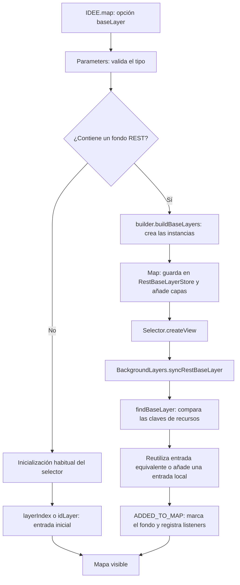
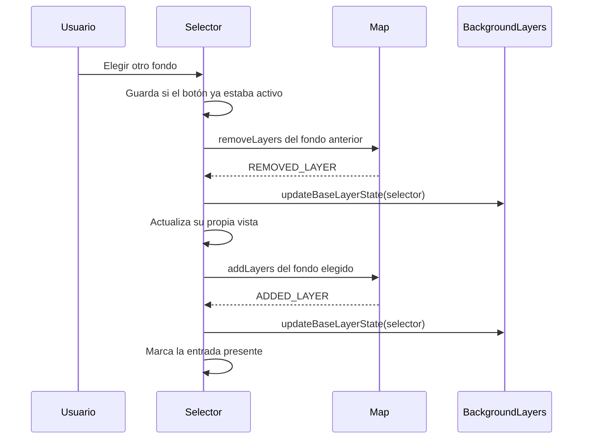

# Depuración de ShareMap y fondos REST

Guía del flujo vigente después de centralizar la lógica común en BackgroundLayers (22/10/2026).

## Preparar DevTools

1. Comprobar que Community Server Connector ha publicado el WAR actualizado de `api-idee-rest/target/api-idee.war`. En la validación de esta revisión, 8080 ya sirve los bundles nuevos.
2. Abrir `http://localhost:8080/api-idee/sharemap.jsp?language=es`.
3. En Network activar **Disable cache** y recargar con DevTools abierto.
4. En Settings > Sources activar **Enable JavaScript source maps**. Los bundles se generan con mapas de fuentes; buscar los archivos originales mediante Ctrl+P. BackgroundLayers pertenece al núcleo y sharemapcontrol al bundle del plugin.
5. Confirmar el código servido en Console:

```js
typeof IDEE.control.BackgroundLayers.syncRestBaseLayer; // "function"
typeof IDEE.control.BackgroundLayers.prototype.syncRestBaseLayer; // "undefined"
typeof IDEE.util.RestBaseLayerStore.getRestBaseLayers; // "function"
```

En `sharemap.jsp` el objeto del mapa se llama `map`. En `test/rest-layer.html` se llama `mapjs`; en `test/test.js` también se expone como `window.map`.

## Flujo de apertura



En un visualizador JSP, `configuration.js` lee GET `baselayer` y lo expone como `IDEE.config.MAP_VIEWER_BASE_LAYER`; el JSP lo entrega al mapa principal. En la ruta REST, `ParametersParser.java` traduce el GET a la opción `baseLayer`. Ambas rutas convergen en el constructor JavaScript.

El constructor conserva la creación y carga del fondo. BackgroundLayers concentra la preparación del catálogo y la selección de los controles. El fondo sigue funcionando sin crear un selector ni ShareMap.

## Métodos de BackgroundLayers

| Método o bloque | Cometido |
| --- | --- |
| `visualProperties` | Set privado con las propiedades excluidas al comparar recursos. Se crea una sola vez. |
| `resource(value)` | Recorre arrays y objetos, ordena sus claves y omite propiedades de presentación/consulta, como leyenda, opacidad, visibilidad, orden, isBase y queryable. Solo construye una representación para comparar: no modifica las capas. |
| `getBaseLayerResourceKey(map, layers)` | Resuelve las definiciones del catálogo, descompone grupos y lee los parámetros de getRestLayer con el parser existente. Devuelve una cadena JSON normalizada para comparar todos los componentes. No devuelve una URL ni crea una identidad global. |
| `findBaseLayer(selector, layers)` | Calcula una vez la clave del fondo recibido y busca una entrada con la misma clave. Devuelve su índice o -1. Si una entrada del catálogo no se puede serializar, continúa buscando. |
| `syncRestBaseLayer(selector, fallbackTitle)` | Consulta el fondo actual del mapa, busca una coincidencia y trabaja sobre una copia del catálogo. Conserva título y previsualización si ya existe; si falta, añade una entrada con leyenda/nombre. Actualiza flattedLayers y activeLayer. No añade capas al mapa. |
| `updateBaseLayerState(selector)` | Lee las capas presentes y visibles. Una entrada está activa si están presentes todos sus componentes. Actualiza visible y activeLayer. Si no hay entrada activa, conserva el último índice para el siguiente cambio móvil. |
| `updateBaseLayerSelection()` | Llama al cálculo común y actualiza las clases CSS de los botones de BackgroundLayers. BackImgLayer tiene su propia versión visual, que llama al mismo cálculo común y actualiza sus previsualizaciones. |
| `getSelectedBaseLayers()` | Devuelve los componentes de la entrada seleccionada. Map los utiliza al calcular el fondo activo y filtra además que sigan presentes y visibles. |
| `destroy()` | Desregistra los listeners añadidos al mapa y continúa la destrucción habitual del control. |

Una misma URL con distinta leyenda u opacidad puede coincidir con una entrada del catálogo y conservar la configuración recibida. Dos capas con el mismo nombre pero distinta URL no coinciden. El catálogo del proyecto no recibe la entrada temporal: se copia antes de modificarlo.

Las funciones `resource` y `getBaseLayerResourceKey` también son métodos estáticos internos de BackgroundLayers. Su recursión y sus llamadas usan `BackgroundLayers.resource` y `BackgroundLayers.getBaseLayerResourceKey`.

En los métodos **estáticos**, `selector` y su alias `control` son el control que se está adaptando. No inspeccionar `this` como si fuera ese control: la llamada se hace sobre la clase.

## Eventos y cambio de fondo

No se han creado nuevos tipos de evento. Se escuchan los eventos existentes:

- `ADDED_TO_MAP`: el control ya tiene la vista lista; se marca la selección inicial y se registran los otros listeners.
- `ADDED_LAYER`: tras añadir capas se recalcula qué entrada está presente y se actualiza su botón.
- `REMOVED_LAYER`: tras retirarlas se desmarca la selección que haya dejado de estar presente.

Los listeners de alta/retirada se activan para mapas que recibieron un baseLayer explícito. Sirven para mantener coherentes ambos selectores cuando otro control o el código cambia las capas. No vuelven a interpretar el GET ni llaman a addLayers: una transición sin fondo entre retirar y añadir no debe recuperar el fondo inicial.

La lectura inicial en syncRestBaseLayer sigue siendo necesaria: las capas REST se añaden antes de crear los selectores y los eventos no se reproducen para oyentes tardíos.



Se guarda antes el estado del botón para que el evento de retirada no altere la decisión de activar/desactivar el botón pulsado. Al destruir un selector se retiran sus listeners, para que un control eliminado no siga reaccionando a cambios posteriores.

## Breakpoints y variables

Las líneas son las del estado de esta revisión; buscar también por nombre de método.

| Escenario | Archivo y línea | Qué observar |
| --- | --- | --- |
| Lectura GET en JSP | `configuration.js:71` y `sharemap.jsp:192` | Valor baselayer y opción enviada al mapa principal. |
| Lectura GET REST | `ParametersParser.java:26` | Requiere depurador Java; transforma la opción para el JavaScript generado. |
| Tipo del parámetro | `Parameters.js:700` | this.baseLayer, typeof this.baseLayer. |
| Creación de instancias | `builder.js:520` | value, definition, layers; en Cesium un grupo se convierte en varias raíces. |
| Añadir el fondo | `Map.js:381` | params.baseLayer; el almacén se rellena antes de los controles y antes del centro/zoom. |
| Decidir REST o inicialización habitual | `BackgroundLayers.js:186` | hasExplicitBaseLayer. Sin GET debe ser false y no entrar en syncRestBaseLayer. |
| Integrar en catálogo | `BackgroundLayers.js:429` | control.map, layers, index, control.layers; index=-1 implica entrada nueva. |
| Comparar recursos | `BackgroundLayers.js:412`, `:391`, `:377` | key frente a la clave de entry.layers, ignorando el estado visual. |
| Vista lista | `BackgroundLayers.js:201` | this.html, this.activeLayer y this.visible antes de registrar listeners. |
| Clic normal | `BackgroundLayers.js:306` y `:390` | isActived antes de removeLayers, y componentes retirados. |
| Cambio móvil | `BackgroundLayers.js:338` | activeLayer antes/después del incremento. El CSS móvil previo tiene sus propias limitaciones. |
| Reacción a eventos | `BackgroundLayers.js:455` y `:463` | present, index, visible y activeLayer. Puede haber index=-1 durante el cambio. |
| Alternativa BackImgLayer | `backimglayercontrol.js:107`, `:177`, `:252` | Delegación a los métodos estáticos; esta clase actualiza su propio HTML. |
| Generar enlace/iframe | `sharemapcontrol.js:351`, `:498`, `:509` | shareBaseLayer, shareLayer, urlAPI_, shareURL. Ambos usan getShareURL_. |
| Incluir el fondo | `sharemapcontrol.js:458`, `Map.js:737` y `RestLayer.js:51` | Fondo actual serializado y valor baselayer añadido al enlace. |
| Generar QR | `sharemapcontrol.js:392` | URL validada, logo y posible enlace acortado. |
| Limpieza | `BackgroundLayers.js:477` y `backimglayercontrol.js:262` | Se desregistran las mismas funciones y contexto usados en on. |

## Pruebas manuales concretas

1. Abrir el JSP sin baselayer. En createView, hasExplicitBaseLayer es false. Se selecciona la entrada configurada (layerIndex, normalmente 0).
2. Activar shareBaseLayer=true, elegir Imagen y abrir Compartir. Seguir buildURL/buildHtml -> getShareURL_ -> prepareShareURLWithBase_ -> map.getRestBaseLayer.
3. Abrir el enlace copiado con los breakpoints de carga preparados. En syncRestBaseLayer se debe encontrar Imagen y reutilizar su entrada, sin duplicarla.
4. Elegir Callejero en el destino. Seguir retirada, REMOVED_LAYER, actualización, alta y ADDED_LAYER. La URL original no se aplica otra vez.
5. Repetir con un fondo ajeno al catálogo. Debe obtener index=-1 y aparecer una entrada nueva con su leyenda/nombre.
6. Repetir con Híbrido para comprobar todos sus componentes.
7. Repetir con BackImgLayer: la búsqueda y preparación deben parar en los mismos métodos estáticos de BackgroundLayers, aunque no haya una instancia del control BackgroundLayers en ese mapa.

Desde Console del JSP:

```js
map.getActiveBaseLayers().map(layer => ({
  name: layer.name, isBase: layer.isBase, visible: layer.isVisible()
}));
map.getRestBaseLayer();
map.getControls().map(control => ({
  name: control.name, activeLayer: control.activeLayer, visible: control.visible
}));
```

Compartir solo el fondo no obliga a pasar por layerToParam: ese método prepara las capas informativas. El fondo sigue map.getRestBaseLayer y cada capa aporta su getRestLayer.

Para probar una definición externa directamente, sin ShareMap:

```js
const rest = new IDEE.layer.OSM({
  name: 'fondo-proyecto', legend: 'Fondo del proyecto', isBase: true
}).getRestLayer();
location.href = `http://localhost:8080/api-idee/sharemap.jsp?baselayer=${encodeURIComponent(rest)}`;
```

## Traducción de la validación

Parameters usa `getValue('exception').invalid_base_layer_type.replace('{type}', typeof this.baseLayer)`. La clave existe en es/en/ca y respeta el idioma activo. Se conserva la validación y el mecanismo Exception del proyecto.

## Estado del empaquetado

El WAR del 21/10 no contenía la centralización del 22/10. El nuevo WAR se generó el 22/10/2026 a las 13:42 (Europe/Madrid). Se recompilaron ambos núcleos y los 28 plugins para OL/Cesium y el reactor Maven terminó correctamente usando el perfil local. Maven reutilizó el frontend ya compilado (`-Dskip.npm=true -Dskip.installnodenpm=true`) y omitió pruebas Java (`-DskipTests`).

Validación separada: lint correcto; 25 pruebas específicas de fondos OL/Cesium correctas; seis bundles del WAR comprobados por hash frente a los recién compilados. En Tomcat 9.0.41 temporal se comprobaron los métodos nuevos, el mensaje en es/en/ca, restauración de Imagen con centro y zoom exactos, cambio a Callejero y equivalencia del enlace y el iframe, sin errores JavaScript. El servidor temporal se retiró al terminar.

Construir el WAR y publicarlo en Community Server Connector son pasos diferentes: la instancia 8080 utiliza la copia desplegada por el conector. Publicar/republicar el archivo actualizado y recargar con la caché desactivada. No se ha copiado manualmente el WAR a webapps ni realizado operaciones de escritura en Git. La comprobación posterior confirmó que el servidor 8080 ya sirve la versión nueva.

Comprobación del 22/10 tras el build: 8080 ya sirve los bundles recién compilados. Si DevTools muestra fuentes anteriores, recargar con la caché desactivada.

Se abrió también el JSP real de 8080 en un navegador nuevo y se confirmaron syncRestBaseLayer estático, getRestBaseLayers del almacén, getShareURL_ y la nueva traducción.

Después de integrar resource y getBaseLayerResourceKey como métodos estáticos se repitieron lint, prebuild, compilación OL/Cesium y las 25 pruebas de fondos, todas correctas, y se volvió a empaquetar el WAR.
